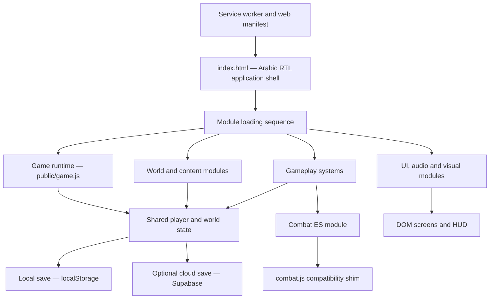

# Legend of the Jade and Sands
### An Arabic-first Eastern Fantasy RPG

Legend is a browser-based role-playing game built around a persistent player journey through a myth-inspired world of regions, factions, companions, quests, combat, crafting, and character progression.

The experience is presented as a single-page application with an Arabic, right-to-left interface. Its gameplay systems are separated into focused JavaScript modules, while a central game runtime coordinates player state, navigation, and persistence.

> **Project status:** This README documents the implementation currently present in the repository. It does not imply that every planned system is complete or that the project has a separate application server.

---

## Contents

- [Core experience](#core-experience)
- [Architecture at a glance](#architecture-at-a-glance)
- [Runtime and module design](#runtime-and-module-design)
- [Game state and persistence](#game-state-and-persistence)
- [Progressive Web App](#progressive-web-app)
- [Technology stack](#technology-stack)
- [Run locally](#run-locally)
- [Build and deploy](#build-and-deploy)
- [Supabase setup and security note](#supabase-setup-and-security-note)
- [Repository layout](#repository-layout)
- [Current engineering boundaries](#current-engineering-boundaries)

## Core experience

The codebase contains systems for:

- **World and lore:** regions, characters, enemies, equipment, and world data.
- **Narrative progression:** story nodes, chapter transitions, story flags, and a chronicle of player decisions.
- **Turn-based combat:** combat state, enemy move selection, telegraphs, turn effects, and move resolution.
- **Character progression:** levels, skills, cultivation, ascension, rebirth, karma, and equipment.
- **Exploration and activities:** regions, caravans, weather, sects, dwellings, and soul-wandering activities.
- **Economy and inventory:** shops, auctions, crafting, alchemy, materials, and equipment.
- **Relationships:** companions, affinity, memories, contextual dialogue, pets, and mounts.
- **Player experience:** responsive game screens, settings, audio, combat visuals, and save/continue flows.

These systems are implemented in the repository's JavaScript modules and are coordinated through a shared game-state object.

## Architecture at a glance

The application follows a **single-page, modular client architecture**. The browser loads the HTML shell, registers the game modules in a deliberate order, and then starts the central runtime.



### Main runtime responsibilities

**`index.html`**
- Defines the application shell and major interface containers.
- Sets the document language to Arabic and the layout direction to right-to-left.
- Loads the Supabase JavaScript client from its CDN.
- Loads the gameplay scripts in dependency order.
- Registers the service worker outside local development.

**`public/game.js`**
- Owns the main runtime state and initialization flow.
- Coordinates screens, player actions, progression, and updates to the interface.
- Validates and merges saved state when restoring a session.
- Saves locally first, then attempts cloud synchronization when Supabase is available.

**Feature modules**
- Expose focused systems and data to the runtime.
- Most classic scripts publish their APIs through the browser's `window` namespace (for example, `window.QUESTS`, `window.SKILLS`, and `window.COMPANIONS`).
- Share and update the central game-state object rather than maintaining separate application stores.

### Combat module boundary

Combat logic is separated from the legacy global-script pattern:

1. `public/combat_engine.js` exports combat functions such as initialization, turn-effect processing, enemy move selection, and move resolution.
2. `public/combat.js` imports the engine as an ES module.
3. The shim exposes the engine as `window.COMBAT` so the existing classic scripts and UI can call it.

This provides a clearer boundary around combat rules while preserving compatibility with the rest of the runtime.

## Runtime and module design

| Area | Main files | Responsibility |
|---|---|---|
| World data | `lore.js`, `lore_part2.js`, `lore_myths.js` | Regions, characters, enemies, items, and lore |
| Story | `story.js`, `story_acts_3_5.js`, `story_epics.js`, `chronicle.js` | Narrative nodes, chapter progression, and story history |
| Combat | `combat_engine.js`, `combat.js`, `combat_ui.js`, `combat_visuals.js) | Combat rules, compatibility bridge, presentation, and effects |
| Character growth | `skills.js`, `cultivation.js`, `ascension.js`, `rebirth.js` | Skills, cultivation, breakthroughs, and legacy progression |
| Economy and items | `shop.js`, `auction.js`, `crafting.js` | Trading, bidding, recipes, and item creation |
| Relationships | `companions.js`, `pets.js`, `life.js` | Companion affinity, pets, mounts, and life systems |
| Exploration | `quests.js`, `weather.js`, `sects.js`, `dwelling.js`, `soul_wandering.js`, `oasis_caravan.js` | Activities, world events, and exploration systems |
| Interface and feedback | `game_screens.js`, `audio.js`, `game.js` | Screens, interactions, audio, and runtime coordination |
| Contextual dialogue | `ai_dialogue.js` | Rule-based dialogue selected from character and player context |

The file named `ai_dialogue.js` currently contains local, context-driven dialogue logic. It should not be interpreted as evidence of a live LLM/API integration.

## Game state and persistence

The runtime keeps the active game in a shared JavaScript state object. That state includes player attributes and progression as well as inventory, equipment, quests, companions, unlocked regions, and other gameplay data.

### Save lifecycle

1. A guest player ID is created and stored in browser storage when one does not already exist.
2. On startup, the runtime attempts to restore the local save from `localStorage`.
3. If the Supabase client is available, the runtime then attempts to retrieve the player's cloud save.
4. When the player makes progress, the game writes the state to `localStorage` first.
5. It then attempts to upsert the same state into the Supabase `game_saves` table.
6. If cloud synchronization is unavailable, local saving remains the fallback.

The current implementation uses:
- Local save key: `legend_rpg_state`
- Player ID key: `rpg_player_id`
- Supabase table: `game_saves`
- Save payload: JSON game state, with `player_id`, `last_login`, and `last_updated` fields.

Cloud persistence is optional; the game can retain progress locally when the cloud table or client is unavailable.

## Progressive Web App

The repository includes a web app manifest and a service worker:

- `public/manifest.json` defines the app name, theme colors, display mode, and icon.
- `public/sw.js` precaches the application shell (`/`, `/index.html`, `/style.css`, and `/manifest.json`).
- The service worker serves cached responses when present and refreshes them from the network in the background.
- During local development, the page unregisters existing service workers and clears browser caches to reduce stale-cache issues.

The service worker provides an app-shell caching layer. It should not be described as a guarantee that every game feature or external service works fully offline.

## Technology stack

| Layer | Technology |
|---|---|
| Application shell | HTML5 |
| Styling and layout | CSS |
| Main application logic | JavaScript (ES modules plus classic browser scripts) |
| Build tooling | Vite 6 |
| Deployment tooling | Cloudflare Vite plugin and Wrangler |
| Optional cloud persistence | Supabase JavaScript client and PostgreSQL |
| Installability and caching | Web App Manifest and Service Worker |

## Run locally

### Prerequisites

- Node.js
- npm

### Installation

```bash
git clone https://github.com/Imenloader/Legend.git
cd Legend
npm install
npm run dev
```

Vite serves the local development site on port **3000**.

Open:

```text
http://localhost:3000
```

The local-development path unregisters service workers and clears browser caches so that an old cached app shell is less likely to interfere with development.

## Build and deploy

### Production build

```bash
npm run build
```

The Vite build output is written to `dist/`.

### Local production preview

```bash
npm run preview
```

This script builds the application and starts a local Wrangler preview.

### Deploy to Cloudflare

Authenticate Wrangler with the Cloudflare account that owns the deployment:

```bash
npx wrangler login
npm run deploy
```

The deploy script runs the production build and then invokes `wrangler deploy`. Deployment settings are defined in:
- `vite.config.js` — Vite, the Cloudflare Vite plugin, build output, and development port.
- `wrangler.jsonc` — Worker name, compatibility settings, observability, and asset handling.

**Hosting note:** the checked-in deployment configuration targets Cloudflare Workers through Wrangler. A Vercel deployment is not configured by these files.

## Supabase setup and security note

The optional SQL bootstrap file is `supabase_setup.sql`. It creates the `game_saves` table with a JSONB state column and timestamp fields.

The current SQL file also creates a policy named `Public Game Saves` with `FOR ALL`, `TO public`, and unrestricted `USING (true)` / `WITH CHECK (true)` expressions. This is permissive: it does not isolate rows by an authenticated user.

**Do not use that policy as-is for production data.** Before enabling cloud saves for real users, replace it with an access model that authenticates users and restricts each user to their own save rows. Review the client-side Supabase configuration in `public/game.js` as part of that deployment. Never put a Supabase `service_role` key in browser code.

If Supabase is not configured or the table is unavailable, the game runtime is designed to fall back to local browser storage.

## Repository layout

```text
.
├── index.html                 # Arabic RTL application shell and script loading order
├── style.css                  # Main visual system and responsive layout
├── assets/                    # Root-level game artwork
├── public/
│   ├── game.js                # Main runtime, state, initialization, and persistence
│   ├── combat_engine.js       # Combat rules as an ES module
│   ├── combat.js              # Exposes the combat engine to legacy scripts
│   ├── combat_ui.js            # Combat interface
│   ├── combat_visuals.js      # Combat presentation and effects
│   ├── lore*.js               # World and character data
│   ├── story*.js              # Narrative and chapter systems
│   ├── quests.js               # Quest definitions and progression
│   ├── skills.js               # Skill definitions and unlock logic
│   ├── cultivation.js         # Cultivation progression
│   ├── crafting.js             # Crafting and alchemy
│   ├── companions.js          # Companion relationships and abilities
│   ├── pets.js                 # Pets and mounts
│   ├── shop.js, auction.js    # Economy systems
│   ├── audio.js                # Audio effects and ambience
│   ├── game_screens.js        # Screen and interface helpers
│   ├── manifest.json          # PWA manifest
│   └── sw.js                   # Service worker
├── supabase_setup.sql          # Optional cloud-save table bootstrap
├── vite.config.js              # Vite and Cloudflare plugin configuration
├── wrangler.jsonc              # Cloudflare deployment configuration
└── package.json                # Scripts and toolchain dependencies
```

## Current engineering boundaries

A few implementation details are important for contributors and reviewers:

- The application is currently a browser-first codebase; the repository does not define a separate backend application or API server.
- Most game systems use shared state and browser-global module namespaces. Preserve the script loading order in `index.html` when changing dependencies between modules.
- Combat is the notable exception: its core rules are exported from an ES module and bridged to the global runtime.
- Save restoration uses defensive state merging and validation, but the current guest-ID and public Supabase policy model is not a production-grade user-ownership system.
- The package scripts currently define `dev`, `build`, `preview`, and `deploy`. A dedicated `test` or `lint` npm script is not currently defined.

Contributions should keep gameplay rules separate from DOM presentation where practical, preserve the local-save fallback, and document any changes to module initialization order or persistence behavior.
